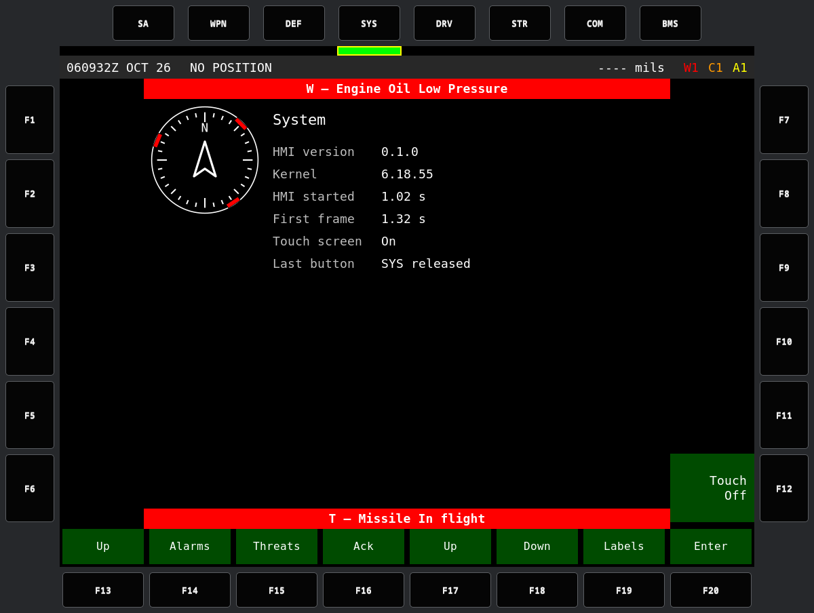
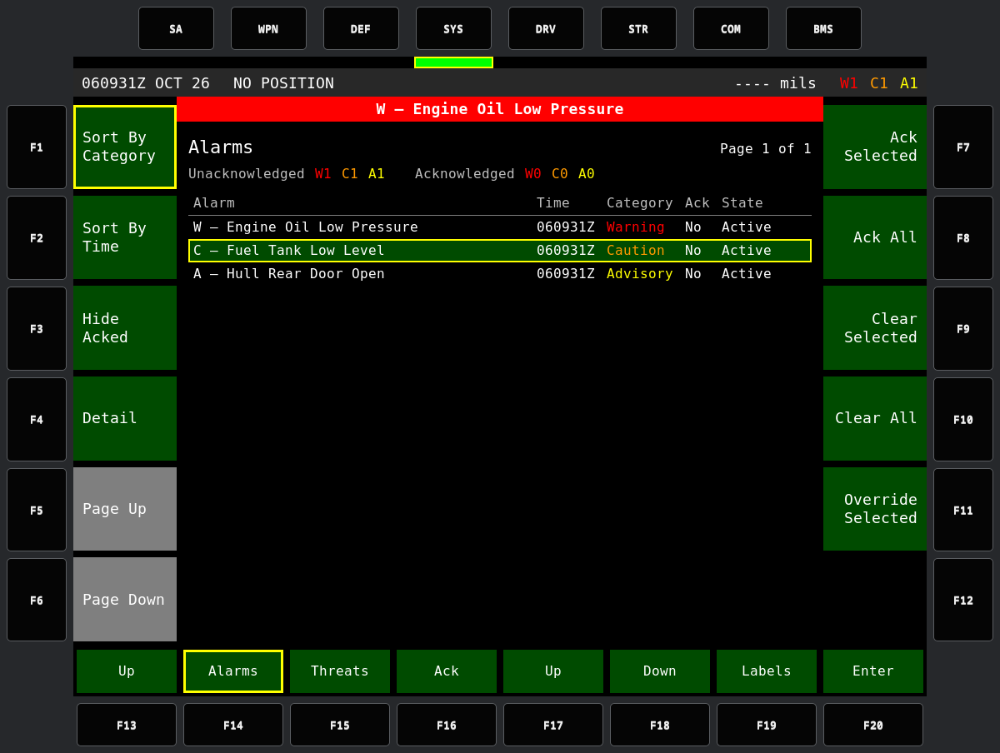
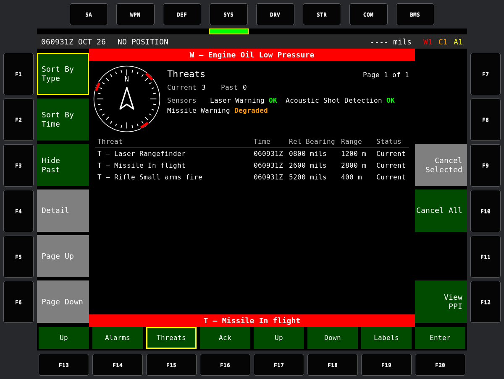
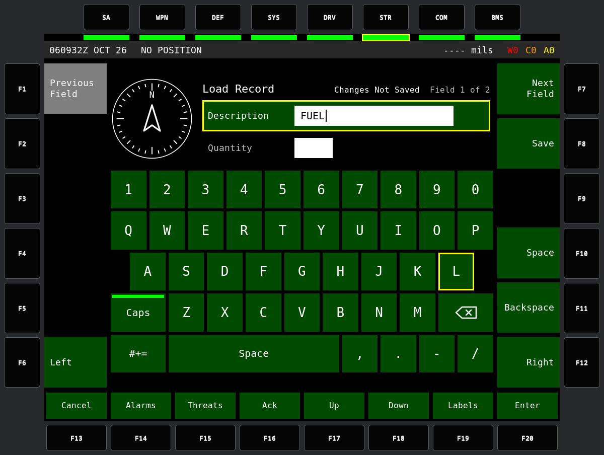
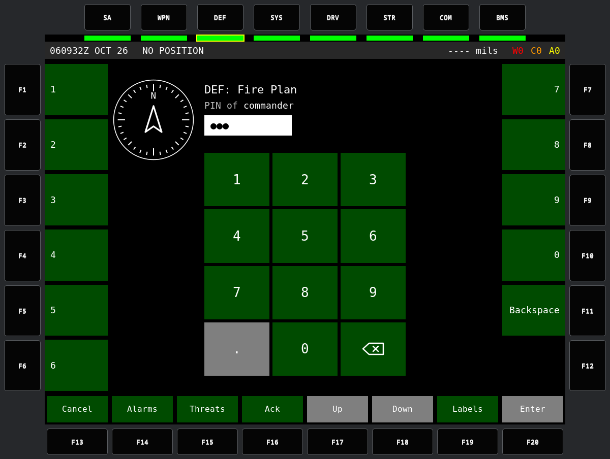
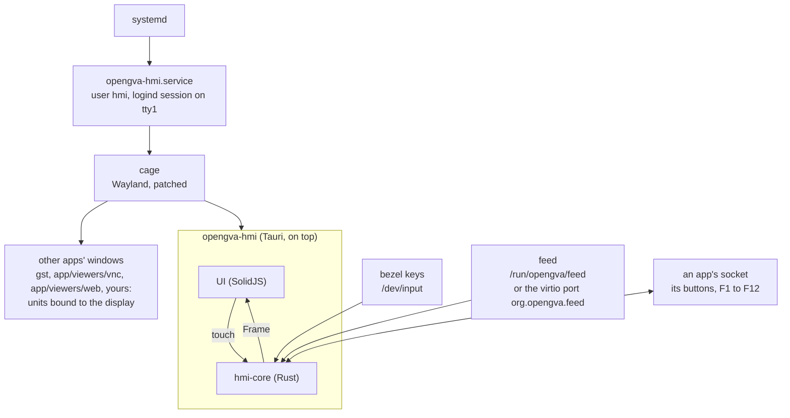

<p align="center">
  <picture>
    <source media="(prefers-color-scheme: dark)" srcset="assets/logo/opengva-on-dark.png">
    
  </picture>
</p>

A base HMI for Generic Vehicle Architecture: the
standard layout, information bar, alarms and threats that every GVA crew station shares.

Built with Rust and a SolidJS UI in Tauri, on a Rocky Linux bootable container
(bootc) image that boots straight into it - no messing around.

Each functional area is something you plug in - another
HMI app, a form, a VNC screen, a web page.

<table>
  <tr>
    <td width="50%" valign="top">
      <br>
      Generic SYS Page
    </td>
  </tr>
  <tr>
    <td width="50%" valign="top">
      <br>
      Alarms table (F14)
    </td>
  </tr>
  <tr>
    <td width="50%" valign="top">
      <br>
      Threats table (F15).
    </td>
  </tr>
  <tr>
    <td width="50%" valign="top">
      <br>
      Input: standard keyboard input with GVA styling 
    </td>
  </tr>
  <tr>
    <td width="50%" valign="top">
      <br>
      Input: numeric-only input with GVA styling 
    </td>
  </tr>
</table>

## Build it

    make container  # localhost/opengva:hmi (slow the first time, then minutes)
    make test       # Rust tests
    make ui         # UI in a browser, no image needed

Needs: `make`, rootless `podman`. Podman keeps every layer that has not
changed, so after an HMI change it recompiles the HMI and no more.

## Use it

The image is the base: put what a crew station needs on it in a layer of
your own.

```dockerfile
FROM localhost/opengva:hmi AS rpm   # packs your files as an RPM
COPY rootfs/ /src/                  # gva-fa.d, units, apps
RUN opengva-rpm my-area "My area" /src

FROM localhost/opengva:hmi          # or from a registry it has been pushed to
RUN --mount=type=bind,from=rpm,source=/rpms,target=/rpms dnf -y install /rpms/*.rpm
RUN systemctl enable my-area.service
```

Everything goes in as an RPM, because the hardened image runs nothing else
([Extend it](#where-the-files-go)).

Last, to harden it, `os/hardened` on top: the DISA STIG (`stig_gui`), no root
login, no serial console. Make a disk of the result with osbuild's
image-builder (`build raw --bootc-ref`), or move a running crew station to it
with `bootc switch`/`bootc upgrade`. Nothing updates by itself.

OpenGVA-Examples does all of that: example layers, the disk, and a VM with
the 28 bezel buttons drawn round it (`make image`, `make run`).

## Architecture

### Inside the image



- hmi-core owns all state and emits a `Frame`; the UI only draws it.
- Areas come from `/etc/opengva/gva-fa.d/*.conf`.
- Logs: `journalctl -u opengva-hmi`; lines starting `OPENGVA ` also go to
  the serial console (boot-timing markers).

## Extend it

Everything is added by your own image layer on `localhost/opengva:hmi`, with
no change to the HMI's code. OpenGVA-Examples has working layers to copy.

### Where the files go

These are absolute paths on the crew station, where your RPM puts them.

| Path on the crew station | What |
|---|---|
| `/etc/opengva/gva-fa.d/NAME.conf` | one functional area per file; any `NAME`, must end `.conf` |
| `/usr/lib/systemd/system/NAME.service` | starts your app on the display ([unit](#the-unit)) |
| `/usr/libexec/NAME/`, `/usr/bin/` or `/opt/NAME/` | your app. Not `/usr/local` or `/var`: on a bootc image those are the machine's, not the image's, so a new image doesn't replace them |
| `/usr/lib/systemd/system-preset/80-NAME.preset` | `enable NAME.service`, so the unit starts without a `systemctl enable` |
| `/etc/opengva/access.conf` | roles and PINs, if any area says `require` (one file for the whole station) |
| `/etc/opengva/vnc.d/NAME.conf`, `/etc/opengva/web.d/NAME.conf` | the built-in [VNC](app/viewers/vnc/README.md) and [web](app/viewers/web/README.md) viewers |

They go in **while the image is built**, not onto a running crew station:
the image is the unit of change (`bootc switch`/`upgrade`). And they go in
**as an RPM**: a hardened image's fapolicyd runs only what an RPM put there,
unchanged since (`os/hardened`), and its build stops on anything runnable
that isn't. OpenGVA's own parts are RPMs the same way (`rpm -qa 'opengva-*'`).

Lay the files out under a directory as they are under `/`, and let
`opengva-rpm` (on the image, `localhost/opengva:hmi`) pack them in a stage
of your Containerfile:

```dockerfile
ARG BASE=localhost/opengva:hmi

FROM $BASE AS rpm
COPY rootfs/ /src/
RUN opengva-rpm my-app "My app's functional area" /src   # NAME SUMMARY DIR

FROM $BASE
RUN --mount=type=bind,from=rpm,source=/rpms,target=/rpms \
	dnf -y install /rpms/*.rpm && dnf clean all
RUN systemctl enable NAME.service
```

`opengva-rpm` keeps each file's mode, marks `/etc` as configuration, and
lets rpmbuild work out what the files need (libraries, interpreters, the
users in a `sysusers.d`), so `dnf` installs those too. `VERSION`,
`RELEASE` and `LICENSE` in its environment set the RPM's (0, 1 and
`Unspecified` otherwise). rpmbuild is not on the image: `opengva-rpm` fetches
it into that stage, which is thrown away.

An RPM of your own, from your own spec, does as well: install it the same
way, with its files at the paths above (`%{_sysconfdir}/opengva/gva-fa.d`,
`%{_unitdir}`, `%{_presetdir}`).

The HMI reads `gva-fa.d` once, when it starts, in file-name order. A file it
cannot use is skipped and the reason is logged:
`journalctl -u opengva-hmi` shows `opengva-hmi: /etc/opengva/gva-fa.d/NAME.conf: line N: why`.

### The `.conf` file

The format is one `name value` per line, separated by spaces or tabs, with
`#` starting a comment. Each file has exactly one `area`. Which kind of area it
is depends on what else it says: a `view` makes it views, a `form` makes it a
form, `tiles` makes it tiles, and otherwise it is one app's window.

**Every kind**

| Name | | Value |
|---|---|---|
| `area` | required | `SA`, `WPN`, `DEF`, `DRV`, `STR`, `COM` or `BMS`. `SYS` is the HMI's own. Each area can be given by one file only |
| `require` | optional, repeatable | roles, space-separated, any one of which will do (lowercase letters, digits, `-`, `_`). Each must be a `role` in `access.conf`, or the area is refused. Choosing the area then asks for a PIN |

**One app's window** (the default)

| Name | | Value |
|---|---|---|
| `window` | required | the app's window [app id](#what-has-to-match-your-app) |
| `overlay` | optional | path of an `.svg` or `.png` drawn over the picture, such as a reticle |
| `keyboard` | optional | `yes`: F5 brings up the on-screen keyboard and what is typed goes to the app. `no` (default) |
| `socket` | optional | path of a Unix socket your app listens on, for its own buttons |
| `key` | optional, repeatable, needs `socket` | `key F1 zoom-in Zoom In`: the button (`F1`–`F12`, not `F5` with `keyboard yes`), an id (one word, unique), then the label |

```
area     WPN
window   gst-launch-1.0
overlay  /usr/share/my-sight/reticle.svg
socket   /run/my-sight/hmi
key      F1  zoom-in   Zoom In
key      F7  laser     Laser
```

**Several apps, one at a time.** Each is a view chosen from the area's menu.

| Name | | Value |
|---|---|---|
| `view` | required, up to 12 | the label on the menu button. The `window`, `overlay`, `keyboard` and `require` lines after it belong to this view |
| `window` | one per view | that view's app id |

Put a `require` before the first `view` to cover the whole area. Labels and
windows must be unique. This kind can't have `tiles`, `form`, `socket` or `key`.

```
area     DEF
view     Status
window   def-status
view     Fire Plan
window   def-fire-plan
require  commander
```

**Several apps at once, as tiles**

| Name | | Value |
|---|---|---|
| `tiles` | required | how many are shown at once, 1 or more |
| `aspect` | optional | the pictures' shape, `W:H`; `4:3` by default |
| `window` | required, up to 12 | the label (one word, shown on its F-button and tile), then the app id |

This kind can't have `overlay`, `keyboard`, `socket` or `key`.

```
area    SA
tiles   4
window  Front  front-camera
window  Rear   rear-camera
```

**A form**, drawn by the HMI itself, with no app behind it

| Name | | Value |
|---|---|---|
| `form` | required | the name (one word), then the title shown on the page |
| `field` | required, 1–8 | the name (one word), then `text`, `number` or `decimal`, then the most characters it holds (1–28), then the title |

```
area   STR
form   load         Load Record
field  description  text    24  Description
field  quantity     number   4  Quantity
```

When the crew save, the form goes out on the vehicle feed as
`{"entered":{"form":"load","fields":{"description":"WATER 20L","quantity":"4"}}}`,
with `null` for a field left empty.

### What has to match your app

| In the `.conf` | Must be the same as |
|---|---|
| `window` (in every kind) | the Wayland **app id** of your app's window. GTK: its application id. GStreamer's `waylandsink`: the app's name, e.g. `gst-launch-1.0`. The VNC and web viewers: the `window` in their own `.conf`. To find it, `journalctl -u opengva-hmi \| grep 'windows open'` lists every open window's id |
| `socket` | the path your app listens on. The HMI connects as user `hmi`, so run the app `User=hmi` with `RuntimeDirectory=` |
| `key` ids | the ids your app receives in `pressed` and `released`, and sends back in `keys` |
| `require` roles | a `role` line in `/etc/opengva/access.conf`, whose holders are the Unix group of that name |
| `form` and `field` names | what the vehicle side reading `entered` expects |
| `overlay` | a file in the image that user `hmi` can read |

The area's bar is grey until a window with that app id is open, then green.

### The unit

```ini
[Unit]
BindsTo=opengva-hmi.service
After=opengva-hmi.service
[Service]
User=hmi
ExecStart=/usr/libexec/opengva/on-display /usr/libexec/NAME/my-app
Restart=always
RestartSec=1
[Install]
WantedBy=opengva-hmi.service
```

`on-display` waits for the HMI's first frame, sets up the Wayland
environment, then runs your app.

### The app's buttons, over `socket`

One JSON object per line, in each direction:

| Direction | Line | When |
|---|---|---|
| HMI → app | `{"ready":true}` | on connecting. Send your buttons now if they differ from the `.conf`'s |
| HMI → app | `{"pressed":"zoom-in"}`, `{"released":"zoom-in"}` | the crew used one, only while the area is on screen and nothing is over it |
| app → HMI | `{"keys":[{"key":"F1","id":"zoom-in","label":"Zoom In","state":"available"}]}` | replaces all the buttons. `state` is `available`, `selected`, `unavailable` or `blank`, and `\n` in a label is a line break |

A new kind of page means editing `hmi-core` and `app/src`.

## Licence

[BSD-3-Clause](LICENSE): use, change and ship it, keeping the copyright
notice with the source and in the documentation of anything built from it;
the OpenGVA name does not endorse what you build. Third-party parts keep
their own licences (noVNC: MPL-2.0, see `app/viewers/vnc/NOTICE`).
